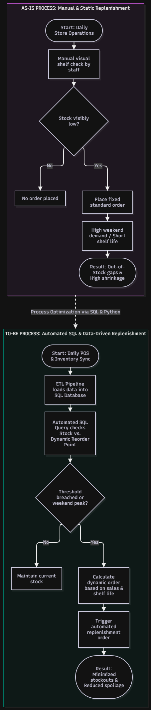
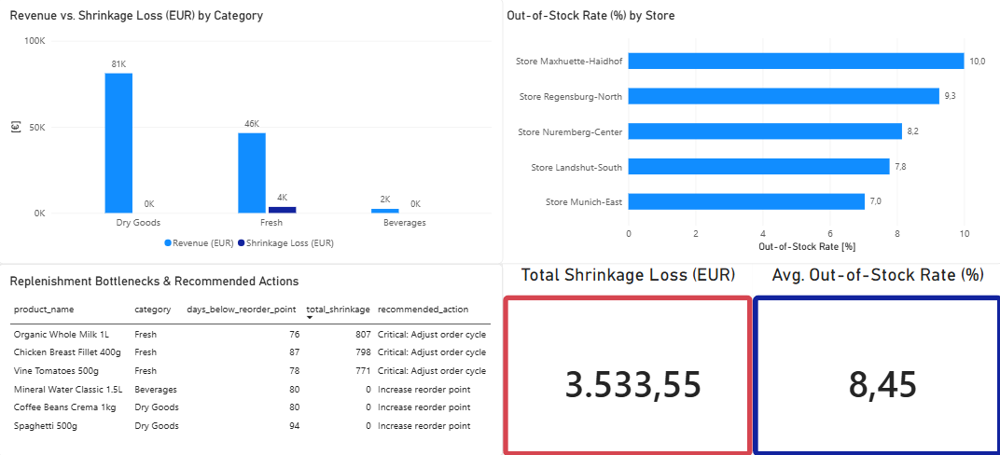

# Retail Inventory & Process Analysis (SQL & Python)

## Project Overview
This project simulates and analyzes core retail logistics and store replenishment processes. The objective is to identify operational bottlenecks—specifically **Out-of-Stock (OOS) events** and **financial losses caused by product shrinkage (spoilage)** in perishable goods.

## Tech Stack
* **Database & Querying:** SQL (SQLite), DDL/DML, Multi-Table Joins, Aggregations, Common Table Expressions (CTEs)
* **Data Pipeline (ETL):** Python (`pandas`, `numpy`, `sqlite3`)
* **Process Modeling & BI:** CSV reporting for Power BI / Excel, As-Is vs. To-Be Process Diagram

## Database Architecture
The relational schema separates master data from daily transactional records:
* `stores`: Store master data (location, region, sales area in sqm)
* `products`: Product catalog including category, shelf life, purchase price, and retail price
* `inventory`: Daily stock levels compared against defined reorder points
* `sales`: Daily units sold and recorded shrinkage (discarded expired goods)

## How to Run
1. *(Optional, recommended)* Create and activate a virtual environment:
   ```bash
   python -m venv .venv
   # Windows:
   .venv\Scripts\activate
   # macOS/Linux:
   source .venv/bin/activate
   ```
2. Install dependencies:
   ```bash
   pip install -r requirements.txt
   ```
3. Create the database and populate it with 90 days of simulated retail data:
   ```bash
   python src/01_generate_data.py
   ```
4. Run the SQL analytical queries and export KPI reports as CSV files:
   ```bash
   python src/02_run_analysis.py
   ```

## Key Findings & Process Optimization
* **Fresh Produce as Primary Loss Driver:** Short shelf lives lead to disproportionate shrinkage costs when order quantities are static.
* **Dynamic Reorder Thresholds:** Fixed reorder points cause weekend stockouts. Implementing automated SQL threshold alerts enables dynamic order adjustments aligned with weekday demand patterns.

### Process Optimization (As-Is vs. To-Be)


### BI Dashboard (Power BI)
